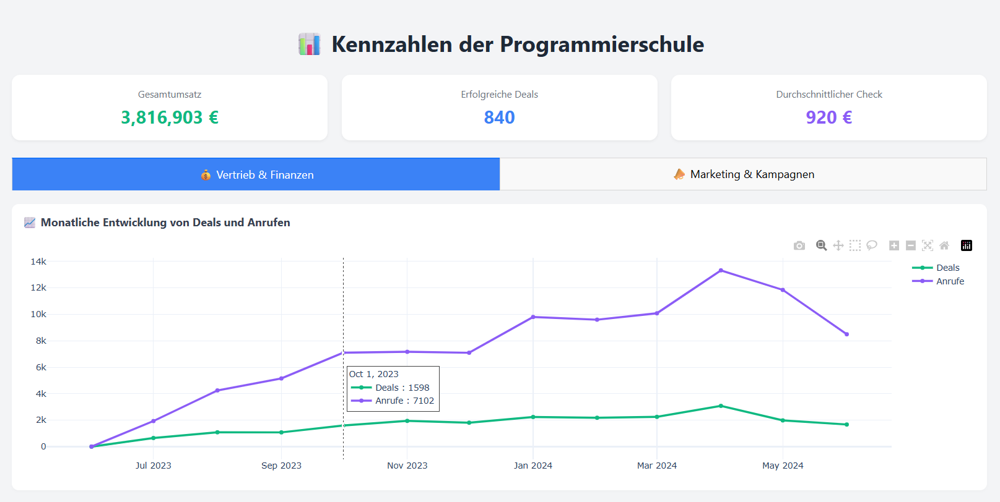
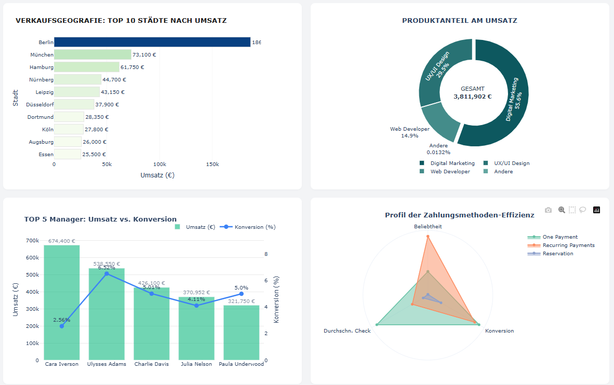
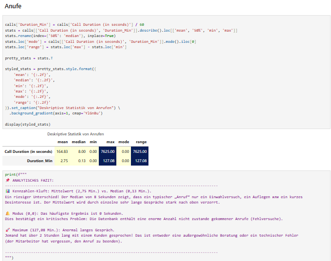
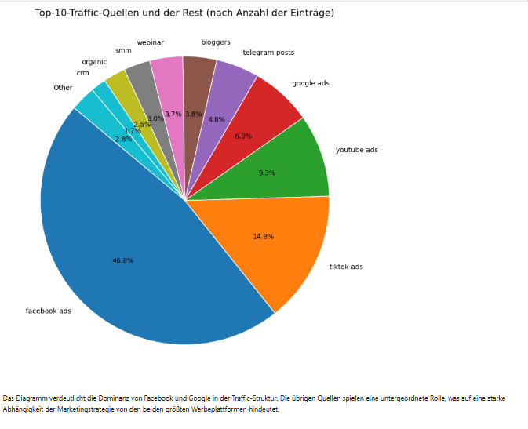

# 📊 Python Data Analysis & Interactive Dashboard

Comprehensive data analysis project focusing on business metrics, sales, marketing campaigns, communication tracking, and unit economics for a programming school, implemented using Python, Jupyter Notebooks, and an interactive Dash web application.

---

## 📸 Project Previews

### 1. Interactive Dashboard
#### Overview & Monthly Trends

#### Detailed Metrics: Top Cities, Product Share, Managers & Payment Methods

### 2. Python & Jupyter Notebook Analysis
#### Call Duration Descriptive Statistics & Insights

#### Traffic Sources Distribution (Top 10 Channels)

---

## 🚀 Project Structure

* **`notebooks/`**: Contains Jupyter Notebooks detailing the step-by-step data exploration and analysis:
  * `Analyse.ipynb`: Main data aggregation and pipeline[cite: 1].
  * `Deskriptive Statistik.ipynb`: Descriptive statistics of datasets[cite: 1].
  * `Analyse der Deals.ipynb`: Sales and deals performance analysis[cite: 1].
  * `Analyse der Ausgaben.ipynb`: Expense tracking and cost analysis[cite: 1].
  * `Anrufanalyse.ipynb` & `Kontaktanalyse.ipynb`: Communication metrics[cite: 1].
* **`data/`**: Excel and CSV datasets (`Calls`, `Contacts`, `Deals`, `Spend`, and `Unit Economics`).
* **`dashboard/`**: Python script (`dashboard_origin.py`) powering the interactive Dash app[cite: 1].
* **`presentation/`**: Final project presentation (`Deutch Project.pptx`)[cite: 1].
* **`assets/`**: Visual previews and screenshots used for documentation.

---

## 💡 Key Findings & Business Insights

* **Traffic Concentration:** Analysis showed a strong dependency on Facebook and Google ads, which drive the majority of traffic and lead volume[cite: 12].
* **Call Quality Discrepancies:** A significant gap between the mean (2.75 min) and median (0.13 min) call duration revealed a large number of missed or short introductory calls[cite: 11].
* **Sales Performance:** Top-performing managers and cities (such as Berlin and Munich) were identified, providing clear targets for resource allocation[cite: 10].
